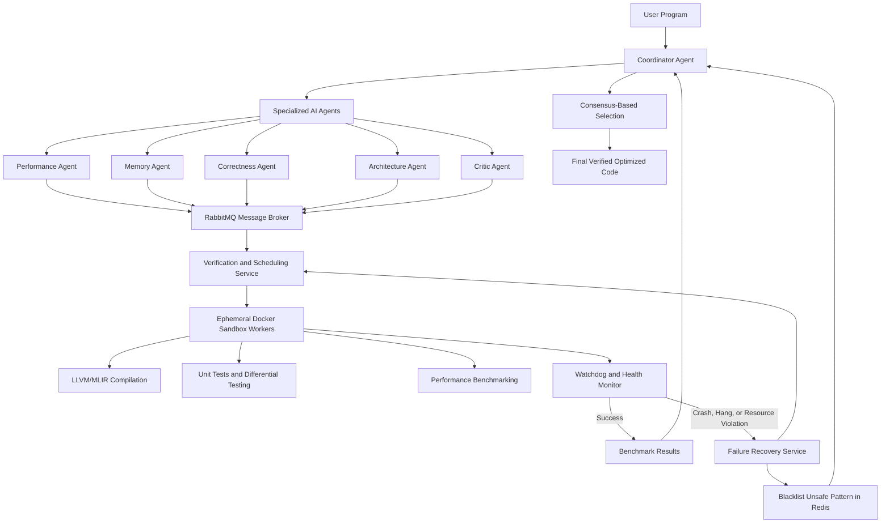

# Title:

**Fault-Tolerant Distributed Compiler Optimizer Using Specialized AI Agents**

# Abstract:

This project develops a distributed compiler optimization system in which multiple specialized AI agents collaboratively generate, analyze, verify, and select compiler optimizations for C, C++, and CUDA programs. The system includes Performance, Memory, Correctness, Architecture, Critic, Benchmark, and Coordinator agents.

Each optimization proposal is versioned, compiled using LLVM/MLIR, executed inside an ephemeral Docker sandbox, tested for semantic equivalence, and benchmarked for performance and memory improvements. To address the risk of unsafe AI-generated code, the system uses watchdog timers, kernel-level resource limits, worker health monitoring, and automatic failure recovery.

If an optimization causes a segmentation fault, memory violation, infinite loop, excessive resource usage, or CUDA kernel hang, the monitoring service detects the failure, terminates and isolates the faulty sandbox, blacklists the unsafe optimization pattern in Redis, and re-queues the task to a healthy worker. The Coordinator Agent evaluates all valid proposals and selects the final optimization using consensus-based decision-making.

The project investigates whether a distributed group of specialized AI agents can produce safer and more effective compiler optimizations than a single AI agent while tolerating communication delays, worker failures, and rogue executions.

# Business Value:

Automated compiler optimization can improve the performance, energy efficiency, and resource utilization of applications used in artificial intelligence, cloud computing, embedded systems, high-performance computing, and GPU-based workloads.

This system provides the following business value:

- Reduces the time and effort required to discover compiler optimizations.
- Improves application performance through automated vectorization, parallelization, loop fusion, memory optimization, and architecture-specific transformations.
- Reduces the risk of unsafe AI-generated code reaching production systems.
- Protects benchmark infrastructure from crashes, infinite loops, memory corruption, and GPU hangs.
- Automatically recovers from failed or unresponsive benchmark workers.
- Prevents repeated execution of known unsafe optimization patterns using distributed blacklisting.
- Supports optimization for CPUs, GPUs, and RISC-V architectures.
- Provides reproducible optimization decisions based on correctness tests and benchmark results.
- Demonstrates a reliable approach for using AI agents in compiler development and software optimization.

# A Proposed Architecture Diagram:

The system operates as follows:

1. The user submits a C, C++, or CUDA program.
2. The Coordinator Agent distributes the optimization task to specialized agents.
3. Agents generate and debate optimization proposals.
4. Proposals are compiled and verified using LLVM/MLIR.
5. Each proposal is executed inside an isolated Docker sandbox.
6. Watchdog services monitor execution time, CPU usage, memory usage, and GPU activity.
7. Successful proposals are unit tested, differentially tested, and benchmarked.
8. Failed or unresponsive workers are terminated and isolated.
9. Unsafe optimization patterns are stored in a distributed blacklist.
10. Failed tasks are re-queued to healthy workers.
11. The Coordinator Agent selects the best correct optimization using consensus and benchmark results.

# Proposed Technology Used:

- **Programming Languages:** Python, C++, C, CUDA
- **Compiler Frameworks:** LLVM, MLIR, Clang, LLVM IR
- **AI Agent Services:** Python-based specialized agents
- **Inter-Agent Communication:** gRPC
- **Message Passing:** RabbitMQ
- **Distributed Cache:** Redis
- **Sandboxing:** Docker containers
- **Resource Isolation:** Linux namespaces, cgroups, seccomp, and `ulimit`
- **Fault Detection:** Watchdog timers, worker heartbeats, health checks, and process monitoring
- **CPU Compilation and Benchmarking:** Clang, CMake, Google Benchmark, and Linux `perf`
- **GPU Compilation and Benchmarking:** CUDA Toolkit, NVIDIA Container Toolkit, and CUDA events
- **Testing:** GoogleTest, pytest, unit testing, randomized differential testing, and fuzz testing
- **Deployment:** Docker Compose
- **Monitoring and Logging:** Prometheus, Grafana, and structured logging
- **Task Recovery:** Retry queues, worker rescheduling, timeouts, and exponential backoff
- **Proposal Management:** Versioned JSON or Protocol Buffers messages
- **Consensus:** Coordinator-based voting and weighted proposal scoring
