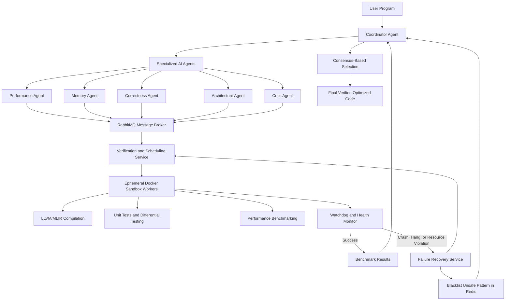

# Title:

**Fault-Tolerant Distributed Compiler Optimizer Using Specialized AI Agents**

## One-command startup and demonstration

All commands and relative paths assume the project root.
With Python 3.11+ and Docker running:

```sh
./project up
./project demo
./project evaluate
```

The launcher builds the native CPU sandbox and starts the application, RabbitMQ,
Redis, Prometheus and Grafana. The demo exercises accepted optimization, automatic
retry on a healthy worker, crash quarantine and correctness rejection. See
[the evaluation and packaging guide](docs/evaluation.md) for budgets, reproduction,
raw evidence, release commands and measured limitations. The
[recorded comparison](benchmarks/results/step16/report.html) reports actual native
ARM64 results; handwritten candidate rules are used, with no external model calls.

## Initial implementation scope

The first milestone targets deterministic C17/C++17 command-line programs on
Linux x86-64 CPUs. CUDA, RISC-V, and MLIR transformations follow after the CPU
pipeline works. The architecture below describes the full planned system.

See the [initial workload and submission contract](docs/initial-workload.md) for
supported programs, build rules, correctness checks, resource limits, and milestone
acceptance criteria. The [sum-array example](examples/sum-array/submission.json)
provides a complete sample submission. These files define the first milestone;
the public source-upload service remains future work. The opt-in first milestone
below connects generation, broker delivery, sandbox checks and final results.

## Development

See [development setup](docs/development.md) for the service package layout,
Python environment, CMake build, formatting commands, tests, and CI checks.
The [versioned message contracts](docs/contracts.md) define submissions, proposals,
verification jobs/results, worker heartbeats, gRPC calls, and RabbitMQ routing.
The [storage layer](docs/storage.md) persists task/proposal history, verification
results, final decisions, and content-addressed artifacts using SQLite and local files.

## Run local infrastructure

```sh
docker compose up --detach --build --wait --wait-timeout 240
python3 tools/check_stack.py
```

See [local infrastructure](docs/local-infrastructure.md) for configuration,
endpoints, health checks, persistent volumes, and shutdown commands. This starts
RabbitMQ, Redis, coordinator intake, scheduler topology management, and a worker
runtime. Compose application services keep queued execution disabled; the opt-in
host coordinator below runs the first complete workflow.

## Run a baseline

```sh
docker compose --profile toolchain build compiler
python -m compiler_optimizer.workers.baseline examples/sum-array --state var/baselines
```

See [baseline execution](docs/baseline.md) for C/C++ package validation, container
limits, persisted binaries/logs, initial timing and memory measurements, and tests.
The [sandbox policy and external watchdog](docs/sandbox.md) enforce syscall,
resource, filesystem, and process isolation and confirm removal after each run.

## Verify an optimization proposal

After creating a baseline, use its printed task ID:

```sh
python -m compiler_optimizer.workers.verify TASK_ID \
  --candidate examples/sum-array-optimized \
  --plan examples/sum-array.verification.json --state var/baselines
```

See [correctness verification](docs/verification.md) for differential tests,
sanitizers, reproducible random/fuzz inputs, numeric tolerances, and persisted
evidence. Proposals reach provisional measurement only after these checks pass.

## Benchmark a verified proposal

```sh
python -m compiler_optimizer.workers.benchmark TASK_ID \
  --verification-job JOB_ID --state var/baselines \
  --plan examples/sum-array.benchmark.json
```

See [reproducible benchmarking](docs/benchmarking.md) for CPU pinning, warmups,
paired repetitions, runtime/memory statistics, durable reports, and conservative
selection gates. Performance qualification requires a native Linux amd64 worker.

## Run the first complete Performance Agent workflow

```sh
python -m compiler_optimizer.coordinator.pipeline \
  --package examples/sum-array --state var/pipeline \
  --verification-plan examples/sum-array.verification.json \
  --benchmark-plan examples/sum-array.benchmark.json
```

The [step 10 guide](docs/performance-pipeline.md) covers structured patches and
rationale, confirmed RabbitMQ delivery, verification, benchmarking, baseline
fallback, crash resumption and coordinator result RPC. The starter Performance
Agent uses a deterministic example rule with a replaceable patch backend.

## Specialized agents

Step 11 adds [Memory and Architecture generators, Correctness and Critic reviews,
and Benchmark work organization](docs/specialized-agents.md). Select a generator
with `--agent memory` or `--agent architecture`; both reviewers and the Benchmark
Agent run automatically. Role-specific objectives and durable iteration limits
apply. Passing automated tests and measured qualification remain mandatory.

## Coordinator selection

Step 12 adds [weighted cohort selection](docs/coordinator-selection.md), with
unanimous Correctness/Critic votes, explicit runtime/memory weights, confidence
bounds, deterministic tie breakers and an immutable decision audit:

```sh
python -m compiler_optimizer.coordinator.round \
  --package examples/sum-array --agents performance,architecture \
  --policy examples/selection-policy.json --state var/selection
```

The original program is retained when no candidate shows a reliable weighted gain.

## Fault recovery

Step 13 adds [leased execution, healthy-worker retries and scoped Redis quarantine](docs/fault-recovery.md).
The cohort CLI enables recovery by default with two local sandbox workers. RabbitMQ
uses manual acknowledgements, confirmed delayed retries and dead letters; stale
workers cannot commit results. Two matching crashes on separate healthy workers
quarantine only the exact transformation, source and execution context. Automated
tests, reviews and measured selection remain mandatory.

Use `--recovery-policy examples/recovery-policy.json` to set bounded attempts,
heartbeat/lease timing, backoff and blacklist expiry. Resume with the stored task ID.

## Observability and failure tests

Step 14 adds [structured JSON events, Prometheus metrics and a provisioned Grafana dashboard](docs/observability.md)
for queue depth, task duration, worker health, retries, crashes and accepted gains.
Compose starts Prometheus at <http://localhost:9090> and Grafana at
<http://localhost:3000/d/compiler-optimizer>. For host optimization commands, serve
the same state directory with `python -m compiler_optimizer.monitoring --state var/cohort --host 0.0.0.0`.
Run `python tools/check_observability.py --require-host` to verify live integration.
Failure tests cover worker termination, duplicate delivery, broker interruption,
infinite loops, memory exhaustion and compiler errors while preserving acceptance gates.

## RISC-V validation and local capabilities

Step 15 implements the [locally testable architecture extension](docs/architectures.md):
controlled target profiles and RV64GC C/C++ correctness validation with QEMU inside
a native Docker container. Mandatory tests and trapping UBSan remain enabled.
Emulator results cannot qualify performance gains; the coordinator retains the original.

```sh
docker compose --profile riscv build compiler-riscv
python -m compiler_optimizer.workers.capabilities --probe
python -m compiler_optimizer.coordinator.round --package examples/sum-array \
  --agents performance --target linux-riscv64 --state var/riscv
```

Offline CUDA compilation is also available without a GPU:

```sh
docker compose --profile toolchain build compiler
docker compose --profile cuda-compile build compiler-cuda
python -m compiler_optimizer.workers.cuda_compile examples/cuda/vector_add.cu
```

CUDA execution remains unavailable on this machine. GPU quarantine/recovery
decision contracts are tested without issuing hardware commands; actual NVIDIA
workers, CUDA-event timing and host recovery await suitable hardware. Compile-only
PTX artifacts explicitly carry no correctness or performance qualification.

# Abstract:

This project develops a distributed compiler optimization system in which multiple specialized AI agents collaboratively generate, analyze, verify, and select compiler optimizations for C, C++, and CUDA programs. The system includes Performance, Memory, Correctness, Architecture, Critic, Benchmark, and Coordinator agents.

Each optimization proposal is versioned, compiled using LLVM/MLIR, executed inside an ephemeral Docker sandbox, tested for semantic equivalence, and benchmarked for performance and memory improvements. To address the risk of unsafe AI-generated code, the system uses watchdog timers, kernel-level resource limits, worker health monitoring, and automatic failure recovery.

If an optimization causes a segmentation fault, memory violation, infinite loop, excessive resource usage, or CUDA kernel hang, the monitoring service detects the failure, terminates and isolates the faulty sandbox, blacklists the unsafe optimization pattern in Redis, and re-queues the task to a healthy worker. The Coordinator Agent evaluates all valid proposals and selects the final optimization using consensus-based decision-making.

The project investigates whether a distributed group of specialized AI agents can produce safer and more effective compiler optimizations than a single AI agent while tolerating communication delays, worker failures, and rogue executions.

# Business Value:

Automated compiler optimization can improve the performance, energy efficiency, and resource utilization of applications used in artificial intelligence, cloud computing, embedded systems, high-performance computing, and GPU-based workloads.

This system provides the following business value:

- Reduces the time and effort required to discover compiler optimizations.
- Improves application performance through automated vectorization, parallelization, loop fusion, memory optimization, and architecture-specific transformations.
- Reduces the risk of unsafe AI-generated code reaching production systems.
- Protects benchmark infrastructure from crashes, infinite loops, memory corruption, and GPU hangs.
- Automatically recovers from failed or unresponsive benchmark workers.
- Prevents repeated execution of known unsafe optimization patterns using distributed blacklisting.
- Supports optimization for CPUs, GPUs, and RISC-V architectures.
- Provides reproducible optimization decisions based on correctness tests and benchmark results.
- Demonstrates a reliable approach for using AI agents in compiler development and software optimization.

# A Proposed Architecture Diagram:



The system operates as follows:

1. The user submits a C, C++, or CUDA program.
2. The Coordinator Agent distributes the optimization task to specialized agents.
3. Agents generate and debate optimization proposals.
4. Proposals are compiled and verified using LLVM/MLIR.
5. Each proposal is executed inside an isolated Docker sandbox.
6. Watchdog services monitor execution time, CPU usage, memory usage, and GPU activity.
7. Successful proposals are unit tested, differentially tested, and benchmarked.
8. Failed or unresponsive workers are terminated and isolated.
9. Unsafe optimization patterns are stored in a distributed blacklist.
10. Failed tasks are re-queued to healthy workers.
11. The Coordinator Agent selects the best correct optimization using consensus and benchmark results.

# Proposed Technology Used:

- **Programming Languages:** Python, C++, C, CUDA
- **Compiler Frameworks:** LLVM, MLIR, Clang, LLVM IR
- **AI Agent Services:** Python-based specialized agents
- **Inter-Agent Communication:** gRPC
- **Message Passing:** RabbitMQ
- **Distributed Cache:** Redis
- **Sandboxing:** Docker containers
- **Resource Isolation:** Linux namespaces, cgroups, seccomp, and `ulimit`
- **Fault Detection:** Watchdog timers, worker heartbeats, health checks, and process monitoring
- **CPU Compilation and Benchmarking:** Clang, CMake, Google Benchmark, and Linux `perf`
- **GPU Compilation and Benchmarking:** CUDA Toolkit, NVIDIA Container Toolkit, and CUDA events
- **Testing:** GoogleTest, pytest, unit testing, randomized differential testing, and fuzz testing
- **Deployment:** Docker Compose
- **Monitoring and Logging:** Prometheus, Grafana, and structured logging
- **Task Recovery:** Retry queues, worker rescheduling, timeouts, and exponential backoff
- **Proposal Management:** Versioned JSON or Protocol Buffers messages
- **Consensus:** Coordinator-based voting and weighted proposal scoring
